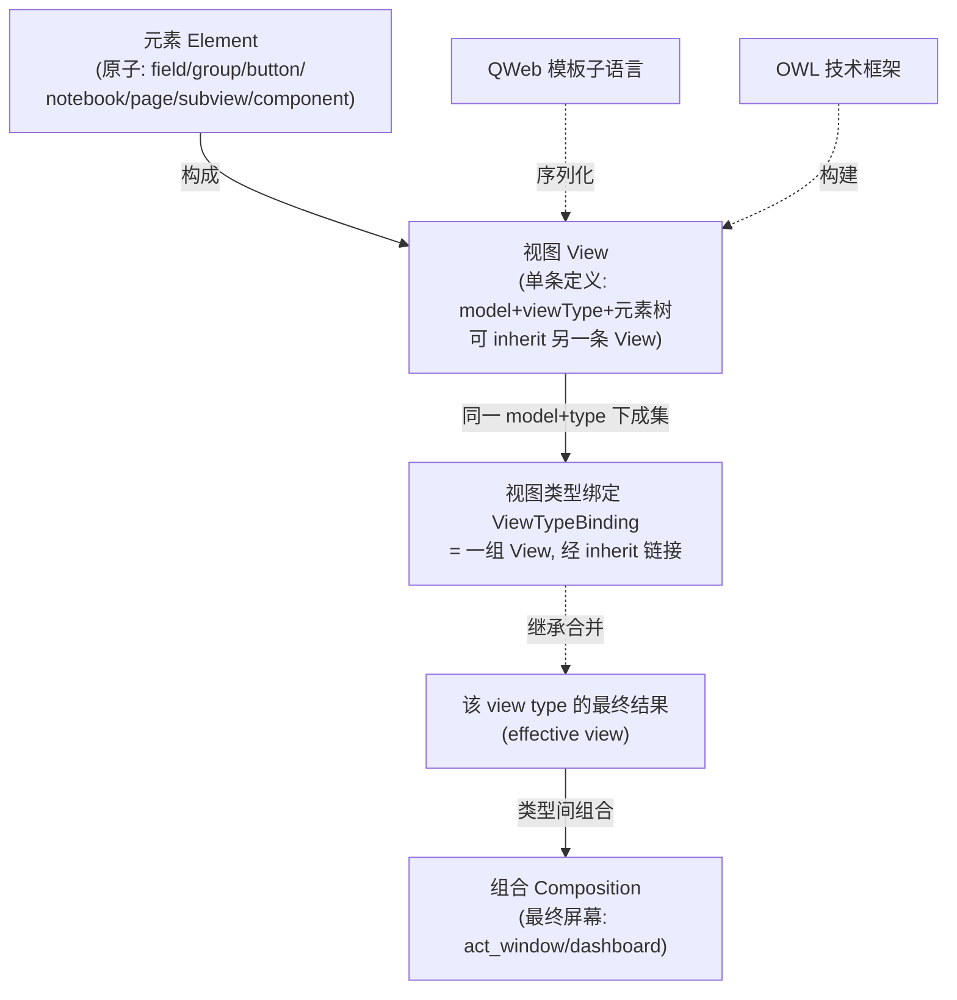
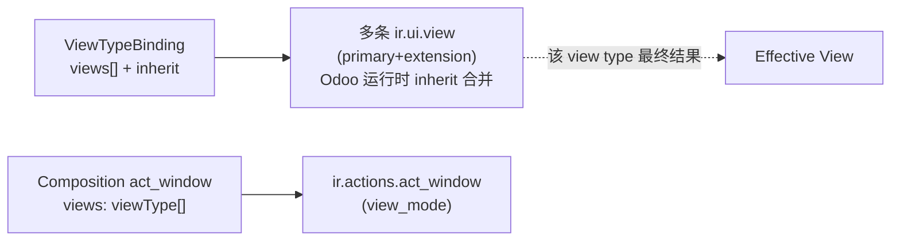
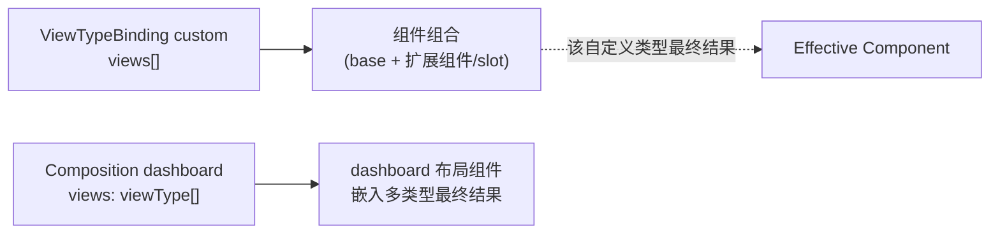

# 统一视图 DSL 设计规范：元素 → 视图 → 视图类型绑定（inherit 合并）→ 组合

> 适用范围：Odoo AI 软件工厂（递归 4 层架构）。
> **本规范的权威载体即本项目**（仓库根 `odoo-view-dsl/`）：实现见 `oview/`（后端 A / 后端 B + `pipeline`）；静态校验见 `validator/`（vendored `dsl_validate.py` + `rng_validate.py`）；参考样例见 `examples/`；本文件为唯一事实来源，不另存他处。
> 起源技能（贡献概念与校验来源）：`odoo-ux-expert`（OWL/QWeb 所有者）、`odoo-qweb-diagnostics`（校验引擎来源）、`odoo-kernel-expert`（模型/ORM 边界）。
> 最高约束：奥卡姆剃刀（如无必要，勿增实体）。本规范的每一项新增实体都必须证明其「减少了上下文/复杂度」。

---

## 0. 定位与边界（结论先行）

1. **OWL 是技术框架，不是 DSL，也不是视图。** 它只是用来*构建*自定义视图客户端组件的手段。
2. **四层概念模型（自上而下）：**
   - **元素 Element**（原子单元）—— field / group / button / notebook / page / separator / label / 子视图嵌入 / 组件嵌入。
   - **视图 View**（单条定义）—— 绑定 (model, viewType)，内部是一棵元素树；可通过 `inherit` 继承另一条 View。
   - **视图类型绑定 ViewTypeBinding**（一组 View）—— 某个 (model, viewType) 下定义的**视图集合**，彼此经 `inherit` 链接。**这组 views 经继承合并的结果，就是该 view type 的最终结果（effective view）**。
   - **组合 Composition**（最终屏幕）—— **多个 view type 的最终结果**组合，才是展示给用户的最终界面（如 `ir.actions.act_window` 的 `view_mode="list,form"`、dashboard 嵌入多类视图）。
3. **两个"组合"层次必须区分：**
   - **类型内组合（inherit 合并）**：同一 (model, viewType) 下的视图集合 → 该类型的最终视图。**这是 Odoo 原生的 `ir.ui.view` 继承机制（primary + extension + xpath）。**
   - **类型间组合（Composition）**：多个 view type → 最终屏幕。
4. **我们要实现的 DSL 覆盖这四层。** QWeb 是两种类型共用的模板子语言，OWL 仅是自定义类型的构建框架。
5. **高级 QWeb 不再漏缝（§3.1）**：`t-if`/`t-foreach`/`t-set`/`t-call`/`t-slot`/动态属性已提升为一等 `Element`；`raw` 降级进 QWeb IR 内部（不绕过管线），并由 QA 打 `seam` 警告逼回声明式。View 始终是唯一事实来源。
6. **DSL 主语言为 YAML**：作者以 YAML 书写规范（可读性最佳、支持注释与多行块），本仓库 `examples/*.yaml` 为权威样例；JSON 仅作兼容/程序生成用途，加载器二者皆收。§2 的 TypeScript 类型仅作**形式化描述**，实际书写/解析/落盘均为 YAML。

> 关键纠正演进：① 不把"标准/自定义"当平行 DSL；② `model` 是 View 层必填绑定；③ 引入 Element 与 Composition；④ 一个 (model, viewType) 由**一组 views** 定义，靠 **`inherit` 继承扩展**，合并结果 = 该 view type 的最终结果；⑤ **缝修复**：高频高级 QWeb 指令提升为一等 `Element`，`raw` 降级进 QWeb IR（不绕过管线）+ QA `seam` 告警，恢复 View 单一来源；⑥ **主语言定为 YAML**（声明式、可读、可注释）。

---

## 1. 概念分层



| 层次 | 角色 | 是否是 DSL 对象 |
| :--- | :--- | :--- |
| **元素 Element** | 原子结构单元，构成视图的最小积木 | ✅ 是（最小单元） |
| **视图 View** | 单条视图定义（ir.ui.view 一条记录级） | ✅ 是（绑定单元） |
| **ViewTypeBinding** | (model, viewType) 下的一组 View，inherit 合并 → 该类型最终结果 | ✅ 是（类型级对象） |
| **Composition** | 多个 view type 的最终结果组合 → 屏幕 | ✅ 是（顶层对象） |
| **QWeb** | 模板子语言；两种类型共用 | 是（Odoo 原生，复用不重造） |
| **OWL** | 响应式组件技术框架；仅自定义类型 | ❌ 否（技术框架） |

---

## 2. 统一视图 DSL 的形式模型（IR）

> **书写语言说明**：下列 TypeScript 类型仅作**形式化描述**（明确判别联合与必填/可选）。DSL 的真实书写语言是 **YAML**（见 `examples/*.yaml`），其结构与此 IR **一一对应**（如 `Element` 判联以 `kind` 字段区分）。JSON 亦可被加载器接受（兼容），但文档与样例一律以 YAML 为准。

```typescript
// ══ 1) 原子单元：元素 ══════════════════════════════
// 来源对齐：标准视图元素词汇以 Odoo 15 `odoo/addons/base/rng/*.rng` 为权威
// （common.rng 共享；tree_view.rng=list；search_view.rng=search；notebook/page 在 form_view.rng）。
// 自定义视图（OWL 后端）不消费 RNG，仅经 §3 模板子语言序列化。
type Element =
  // —— 共享元素（common.rng：form/list/search 通用）——
  | { kind: "field";    name: string; widget?: string; string?: string; options?: Record<string,unknown>;
      invisible?: Expr; readonly?: Expr; required?: Expr; domain?: Expr; context?: Expr;
      groups?: string; colspan?: number; nolabel?: boolean; placeholder?: string;
      children?: Element[];                                  // RNG 允许 field 嵌套子元素
      extra?: Record<string,unknown> }                       // 长尾属性(decoration-*/digits/filename…)→raw attr(§3.2)
  | { kind: "group";    string?: string; col?: number; name?: string; groups?: string; children: Element[] }
  | { kind: "button";   string: string; type: "object"|"action"|"special"; name?: string;
      icon?: string; invisible?: Expr; groups?: string; confirm?: string; context?: Expr;
      "aria-label"?: string; default_focus?: boolean }
  | { kind: "separator"; string?: string; colspan?: number; orientation?: string; name?: string; groups?: string }
  | { kind: "label";    for?: string; string?: string; colspan?: number; nolabel?: boolean; invisible?: Expr }
  | { kind: "image";    name: string }                                   // common.rng <image name>
  | { kind: "html";     arch?: QWebArch }                                // common.rng <html>（含 QWeb 指令）
  | { kind: "newline";  }                                                // common.rng <newline/>
  // —— 类型专属元素（校验器按 viewType 限定作用域，见 §6.5）——
  | { kind: "notebook"; pages: Page[] }                                  // form 专属（form_view.rng）
  | { kind: "page";     string: string; children: Element[] }            // form 专属
  | { kind: "header";   children: Element[] }                            // form/list 顶部条（tree_view.rng）
  | { kind: "filter";   name: string; string?: string; domain?: Expr; context?: Expr; date?: string; groups?: string } // search 专属
  | { kind: "searchpanel"; view_types?: string; children: Element[] }   // search 专属（search_view.rng）
  | { kind: "groupby";  name: string; expand?: boolean; children: Element[] } // list 专属（tree_view.rng，限 field/button）
  | { kind: "control";  creates: { string: string; context: Expr }[] }   // list 专属（tree_view.rng，x2many 内联新增）
  // —— 组合 / 自定义 ——
  | { kind: "subview";  viewRef: ViewRef }                  // 嵌入另一 View（组合）
  | { kind: "component"; component: string; props?: Record<string,Expr> }  // 自定义：嵌组件
  // —— 高级 QWeb 指令：提升为一等元素，避免回落 raw（缝的修复，见 §3.1）——
  | { kind: "if";        cond: Expr; children: Element[]; else?: Element[] }    // t-if / t-elif / t-else
  | { kind: "foreach";   expr: Expr; as: string; children: Element[] }          // t-foreach / t-as
  | { kind: "set";       var: string; value?: Expr; children?: Element[] }      // t-set / t-value（或含子节点）
  | { kind: "slot";      name: string; fallback?: Element[] }                   // t-slot（自定义视图组件组合）
  | { kind: "dynamicAttr"; attr: string; value: Expr|FString; mode?: "attr"|"f"|"map" } // t-att-* / t-attf-* / t-att
  | { kind: "call";      name: string; with?: Record<string,Expr>; block?: Element[] } // t-call 命名片段（见 fragments）
  // —— 逃逸舱：仅限 QWeb 覆盖不到的极端场景；必填 reason，且被降低进 QWeb IR 内部（不绕过管线，见 §3.1/§6.4）——
  | { kind: "raw";       qweb: QWebArch; reason: string };          // 逃逸舱（最后手段，QA 标缝）

type Page = { string: string; children: Element[] };

// ══ 2) 视图：单条定义（→ ir.ui.view 一条记录）════
type View = {
  id: string;                       // 视图标识（→ ir.ui.view.xml_id）
  model: string;                    // 必填：绑定 Model
  viewType: ViewTypeRef;            // 标准 type 名 或 自定义 type 名
  name?: string;
  inherit?: string;                 // 父视图 id（→ inherit_id）；base 视图省略
  mode?: "primary" | "extension";  // base=primary（默认），扩展=extension
  elements: Element[];              // 主视图=全量元素；扩展视图通常经 patches 增量
  patches?: Patch[];               // extension 视图对父 arch 的 xpath/position 修改
  fields: FieldRef[];               // 引用到的模型字段（供校验）
};

type Patch = {
  xpath: string;                   // 定位父 arch 节点
  position: "inside"|"after"|"before"|"replace"|"attributes";
  elements?: Element[];            // 注入的元素
  attrs?: Record<string,string>;   // position=attributes 时设置属性
};

type ViewRef = { id: string } | { model: string; type: string; name?: string };
type ViewTypeRef = string;         // "form" | "list" | "dashboard" | ...

// 自定义视图类型定义（标准类型由 Odoo 内建，无需定义）
type CustomType = {
  type: string;
  entry: { type: "client-action"; tag: string }
       | { type: "custom-view-mode"; name: string };
  component: ComponentContract;
  style?: boolean;
};
type ComponentContract = {
  name: string;
  props?: Record<string, PropSpec>;
  state?: Record<string, StateSpec>;
  services?: string[];  hooks?: HookSpec[];  events?: string[];
  slots?: string[];     a11y?: A11ySpec;
};

// ══ 3) 视图类型绑定：一组 View，inherit 合并 → 该类型最终结果 ══
type ViewTypeBinding = {
  model: string;
  viewType: ViewTypeRef;
  views: View[];                   // base(primary) + 若干 extension，经 inherit 链接
  fragments?: Fragment[];          // 命名可复用 QWeb 片段（t-name 等价），供元素 `call` 引用；消除 macro 回落 raw
  // 组合结果 = views 沿 inherit 链合并后的 effective arch（即"该 view type 的最终结果"）
};
type Fragment = { name: string; params?: string[]; children: Element[] };

// ══ 4) 组合：多个 view type 的最终结果 → 最终屏幕 ══
type Composition = {
  name: string;
  kind: "act_window" | "dashboard";
  model?: string;
  views: ViewTypeRef[];            // 参与组合的多个 view type（各自已是合并后的最终结果）
  viewMode?: string;               // act_window: "list,form"
  layout?: LayoutSpec;             // dashboard: tabs/columns/grid
};
type LayoutSpec =
  | { type: "tabs";    tabs: { label: string; views: ViewTypeRef[] }[] }
  | { type: "columns"; columns: ViewTypeRef[] }
  | { type: "grid";    cells: ViewTypeRef[][] };
```

**IR 语义链**：`Element` 积木 → `View`(单条, 可 `inherit`) → `ViewTypeBinding`(同 model+type 的视图集合, **inherit 合并 = 该类型最终结果**) → `Composition`(多个类型组合 = 屏幕)。类型内 `inherit` 是标准视图的 Odoo 原生机制；自定义视图以组件组合实现同义"类型最终结果"（见 §5 注）。

---

## 3. 模板子语言：QWeb 文法（两种类型共用）

`Element` 在生成阶段序列化为 QWeb 节点（标准视图走 Odoo 语义标签 → 内部转 QWeb；自定义视图直出 QWeb）。QWeb 文法作为共享模板子语言不复述重造：

```ebnf
QWebDoc ::= Element*
Element ::= Tag [Attrs] (Element | Text | Directive)*
Attrs   ::= (StaticAttr | DynamicAttr | ControlAttr | BindingAttr)*
StaticAttr   ::= Name '="' Value '"'
DynamicAttr  ::= 't-att-' Name '="' Expr '"' | 't-att' '="' MapExpr '"' | 't-attf-' Name '="' FString '"'
BindingAttr  ::= 't-esc' '="' Expr '"' | 't-out' '="' Expr '"' | 't-field' '="' FieldRef '"' ['t-options' '="' OptMap '"']
ControlAttr  ::= 't-if' '="' Expr '"' | 't-elif' '="' Expr '"' | 't-else'
               | 't-foreach' '="' Expr '"' 't-as' '="' Var '"'
               | 't-set' '="' Var '"' ('t-value' '="' Expr '"' | Text)
               | 't-call' '="' TplName '"' ['t-call-block']
Directive    ::= 't-name' '="' TplName '"' | 't-debug' | 't-log' '="' Expr '"' | 't-translation' | 't-js' '="' Expr '"'
```

**文法铁律（两类型强制）**：服务端模板根由视图类型隐式确定；客户端模板根必须 `t-name`；控制流只走属性位；用户可控数据一律 `t-esc`/`t-field`，`t-out` 仅限受信后台。

### 3.1 高级 QWeb 覆盖与逃逸舱（缝的修复）

**问题**：早期设计中，频繁的高级 QWeb 模式（`t-if`/`t-foreach`/`t-set`/`t-call`/`t-slot`/动态属性）不是 DSL 一等元素，作者被迫回落 `raw` QWeb；而 `raw` 若不进管线，会破坏 View 的"单一来源"——继承、组合、校验都对它失效，产生"DSL 视图 + 原生 arch"的混合缝。

**修复 = 三原则**：

1. **高频指令一等化（覆盖缝）**：`if` / `foreach` / `set` / `slot` / `dynamicAttr` / `call` 直接是 `Element` 种类，与 `field`/`group` 同级。作者 90% 的"高级"需求在声明式表面内解决，无需 `raw`。`macro`/`t-call` 等价物以 `ViewTypeBinding.fragments[]`（命名片段）+ 元素 `call` 实现，复用而不回落。

2. **`raw` 降级进 QWeb IR（含纳缝，不绕过）**：`raw` 不再"绕过"生成管线，而是被**降低（lower）为 QWeb IR 内部的 `RawNode`**，与一等元素共用同一条序列化/继承/组合/校验路径。`raw` 必须带 `reason: string`（说明为何 DSL 无法表达），否则校验拒绝。于是"单一来源"恢复——View 始终是唯一事实，无论节点是声明的还是透传的。

3. **QA 缝警告（逼回声明式）**：校验器对**每一个 `raw`** 报 `seam` 级告警（非 pass）。目标：标准视图 `raw` 数 → 0；自定义视图 `raw` 仅限 DSL 确实无对应元素的极端场景。每次 `raw` 都应触发"能否新增一个 Element 种类"的复盘。

**两层降低管线（关键）**：`DSL Element` → `QWeb IR`（含 `RawNode`）→ `XML`。所有节点（声明式与 `raw`）先汇聚到 QWeb IR，再统一序列化；继承/组合的合并在 QWeb IR 层完成，因此 `raw` 透传的片段也会被 inherit 链与 Composition 正确合入，不再游离于体系之外。

```ebnf
QWebIR       ::= Node*
Node         ::= DeclNode | RawNode                 // 声明节点 或 逃逸节点，同处一层
RawNode      ::= { kind: "raw"; qweb: QWebArch; reason: string }   // 必须 reason
DeclNode     ::= Field | Group | If | Foreach | Set | Slot | Call | DynamicAttr | ...
```

### 3.2 元素词汇对齐 Odoo 15 RNG（权威来源）

标准视图的元素合法集合**以 `odoo/addons/base/rng/*.rng` 为唯一权威**，DSL 不另行发明节点。已逐文件对齐：

| RNG 文件 | 提供元素 | DSL 映射 |
| :--- | :--- | :--- |
| `common.rng` | `field`(含 ~40 可选属性 + 可嵌套子元素)、`group`、`button`、`separator`、`label`、`image`、`html`、`newline`、`xpath`(overload) | 共享 `Element` 主体；`xpath`/`overload` 映射为 `Patch`（`position` before/after/inside/replace/attributes + 嵌套 `attribute`） |
| `tree_view.rng` | `tree`/`header`/`control`/`create`/`groupby` | `header`(共享)、`control`/`groupby`(list 专属) |
| `search_view.rng` | `search`/`searchpanel`/`filter` | `searchpanel`/`filter`(search 专属) |
| `form_view.rng`(本目录未含，按 Odoo 15 标准) | `form`/`sheet`/`notebook`/`page`/`header` | `notebook`/`page`(form 专属) |

**属性长尾与 `extra` 收口**：RNG 的 `field` 等含大量低频属性（`decoration-*`、`digits`、`filename`、`states`、`password`、`statusbar_visible`…）。DSL 只把高频项（`name`/`widget`/`string`/`invisible`/`readonly`/`required`/`domain`/`context`/`groups`/`colspan`/`nolabel`/`placeholder`）列为一等字段；其余一律走 `field.extra: Record<string,unknown>`，生成器将其**逐键降级为 raw 属性节点**——这是"属性级"窄缝（仍在 QWeb IR 内，受校验与合并约束），与"节点级" `raw` 逃生舱分层。目标：`extra` 使用率 < 高级属性总需求，且每个 `extra` 键若高频出现应回流为一等字段。

**`groups` 访问控制**：`field`/`group`/`button`/`separator`/`label`/`filter` 均带 `groups?`（RNG `access_rights`），生成器原样产出 `@groups`，DSL 不重新解释权限语义。

---

## 4. 编译后端 A：标准 View / ViewTypeBinding / Composition → 服务端

**View（标准，单条）**：`View{ id, model, viewType:标准, elements[] }` → 一条 `ir.ui.view` 记录（arch 由 `elements` 序列化）。`inherit`/`mode`/`patches` 直接映射 Odoo 继承字段。
**ViewTypeBinding（标准）**：同一 (model, type) 下的**视图集合** → **多条 `ir.ui.view` 记录**（base=primary，其余=extension + `inherit_id` + xpath）。**Generator 不预合并**——这组记录交给 Odoo 运行时按 inherit 链合并，得到"该 view type 的最终结果"。
**Composition（act_window）**：`Composition{ kind:"act_window", model, views:[list,form] }` → `ir.actions.act_window`（`res_model`, `view_mode="list,form"`, 经 `ir.actions.act_window.view` 关联各 view type 的最终结果）。



**校验（继承专用）**：inherit 链必须收敛到一条 primary base；无环；extension 的 xpath 目标须存在于 base（或上游）arch；`model` 与 `viewType` 合法；`fields` 属 `model`。

---

## 5. 编译后端 B：自定义 View / ViewTypeBinding / Composition → OWL 组件成果

**View（自定义，单条）**：`View{ model, viewType: custom, elements[] }` → OWL `.js` + `.xml`（QWeb 模板，由 `elements` 序列化）+ `.scss`，并 **type↔model 注册**。
**ViewTypeBinding（自定义）**：同一 (model, customType) 的视图集合，其"inherit 合并"语义映射为**组件组合**——base 组件提供骨架与 `slots`，extension 视图以额外可组合组件 / slot 覆盖实现"该自定义类型的最终结果"（Owl 模板无 xpath 继承，故以组合代替换行合并）。
**Composition（dashboard）**：`Composition{ kind:"dashboard", views:[...] }` → 布局组件按 `layout`（tabs/columns/grid）嵌入多个已生成的 view type 最终结果组件。



**生成规则（硬约束）**：`*.js` 禁 `get xxx()`（用 `useState`/`useCompute`）、禁 `patch` 框架、必显式声明 `services`；`*.xml` 自动带 `t-att-aria-*`；注册不擅自改全局 `assets` bundle。自定义视图 props 来自 action context / env services，`model` 决定"对哪个模型展示"。

---

## 6. 约束、反模式与 QA 卡控

### 6.1 奥卡姆红线（本规范新增实体）
- ✅ 允许：四层 DSL（**Element / View / ViewTypeBinding / Composition**）+ 共享 QWeb 模板子语言。
- ❌ 禁止：把"标准/自定义"当平行 DSL；`model` 可选；停在单 View 不建模"一组 views 的 inherit 合并"；在 QWeb 之上再包通用视图 DSL（除非 §4 批量场景）；把自定义类型扩成前端全栈 DSL。

### 6.2 无障碍即 DSL 级注解（A1–A9，贯穿四层）
- **A1** 语义优先：生成 `<button>`/`<a>`/`<label>`，不得可点击 `<div t-on-click>`。
- **A2** 图标按钮带 `t-att-aria-label`；**A3** 对话框 `Esc`+焦点陷阱；**A6** 状态不靠颜色；**A8** 输入有真实 `<label for>`。
- 缺省 a11y 注解的自定义组件/元素在 QA 门报 **incomplete（非 pass）**。

### 6.3 安全红线
- QWeb 用户可控数据必须 `t-esc`/`t-field`；`t-out` 仅限受信后台。
- 自定义视图 `services` 调用必须显式声明（绑定 `ComponentContract.services`）。

### 6.4 逃逸舱与缝卡控（§3.1 的 QA 落地）
- **`raw` 必带 `reason`**：缺 `reason` 的 `raw` 直接判 **ERROR**（拒绝"懒政式透传"）。
- **`raw` 必须降级进 QWeb IR**：Generator 不得把 `raw` 直接拼进最终 XML 而未过 QWeb IR 层；违者视为绕过管线 **ERROR**。
- **缝告警**：每个 `raw` 节点报 `seam` 级告警。**标准视图目标 `raw` 数 = 0**；自定义视图 `raw` 仅限 DSL 确无对应元素的极端场景。
- **`call`/`fragments` 收敛检查**：`call.name` 必须存在对应 `Fragment`；未定义片段判 **ERROR**（替代"手写 t-call 字符串"的游离）。

### 6.5 元素作用域与 RNG 终审（grounding 落地）

- **类型作用域**：校验器按 `viewType` 限定元素种类，禁止跨类型误用：**`notebook`/`page` 仅 form**；**`filter`/`searchpanel` 仅 search**；**`groupby`/`control` 仅 list/tree**；`header` 限 form/list。越界判 **ERROR**。
- **RNG 终审**：标准视图生成的最终 `arch` **必须**通过对应 `*.rng`（form→`form_view.rng`、list→`tree_view.rng`、search→`search_view.rng`）。建议校验器复用 Odoo 的 RNG（或等价生成的校验器）作为"合法 arch"的**终极权威**，本 DSL 的 IR 级检查是前置快筛，不替代 RNG。
- **`extra` 键复核**：`field.extra` 的每个键必须存在于目标 RNG 的 `field` 属性集中；未知键判 **ERROR**（防止拼写漂移，如 `decoation-danger`）。

---

## 7. 参考样例

### 7.1 ViewTypeBinding：一组 views 经 inherit 合并为该类型最终结果（标准，后端 A）
```yaml
viewTypeBinding:
  model: stock.move
  viewType: form
  views:
    - id: stock_move_form_base
      mode: primary
      elements:
        - group: { children: [ { field: { name: product_id } }, { field: { name: quantity } } ] }
        - field: { name: state }
    - id: stock_move_form_ext
      inherit: stock_move_form_base
      mode: extension
      patches:
        - xpath: "//field[@name='state']"
          position: after
          elements: [ { button: { string: "Validate", type: object, name: action_validate } } ]
```
生成两条 `ir.ui.view`（base primary + extension inherit_id=base），Odoo 运行时把按钮并入 form —— **这组 views 的合并 = 该 form 类型的最终结果**。校验器检查 inherit 链收敛、xpath 目标存在、字段属 `stock.move`。

### 7.2 Composition：多个 view type 组合成最终屏幕
```yaml
composition:
  name: "Stock Operations Console"
  kind: act_window
  model: stock
  viewMode: "list,form"
  views: [list, form]          # 各为 (stock.move, list)/(stock.move, form) 的最终结果
---
composition:
  name: "Inventory Dashboard"
  kind: dashboard
  layout: { type: tabs, tabs: [
    { label: "Overview", views: [dashboard] },
    { label: "Moves",    views: [list] }
  ]}
```

### 7.3 自定义 View（后端 B：custom type + 绑定 model → OWL 组件）
```yaml
view:
  id: stock_dashboard_view
  model: stock
  viewType: dashboard
  elements:
    - component: { component: KpiCard, props: { metric: "stock.value" } }
viewType:                              # 自定义类型定义（一次）
  type: dashboard
  entry: { type: client-action, tag: stock.dashboard }
  component: { name: StockDashboard, props: { context: Object }, services: [rpc], a11y: { role: main } }
  style: true
```
生成 `stock_dashboard.js`(OWL 组件) + `.xml`(QWeb) + `.scss` + type↔model 注册。

### 7.4 高级 QWeb 一等元素（无 raw 缝）：条件 / 循环 / 变量 / 复用片段 / 组件槽

```yaml
viewTypeBinding:
  model: sale.order
  viewType: form
  fragments:                                    # 命名片段（t-name 等价）→ 元素 call 复用
    - name: amount_badge
      params: [value]
      children: [ { set: { var: warn, value: "value > 1000" } },
                  { if: { cond: "warn", children: [ { label: { string: "High" } } ] } } ]
  views:
    - id: sale_form_adv
      mode: primary
      elements:
        - foreach: { expr: "record.order_line", as: "line", children: [   # t-foreach
            { if: { cond: "line.price_subtotal > 0", children: [
                { field: { name: "price_subtotal" } } ] } } ] }
        - set: { var: total, value: "record.amount_total" }               # t-set / t-value
        - call: { name: amount_badge, with: { value: "total" } }          # t-call 片段
        - component: { component: KpiCard, props: { metric: "total" } }   # 自定义：组件
        - slot: { name: footer_extra, fallback: [ { button: { string: "Print", type: action } } ] }  # t-slot
```

以上全部为声明式一等元素，**零 `raw`**。生成器将其降低为 QWeb IR（含对应 `t-if`/`t-foreach`/`t-set`/`t-call`/`t-slot` 节点）再序列化；继承链与 Composition 在 QWeb IR 层正常合入。仅当遇到 DSL 确实无对应种类的极端 QWeb（如自定义 `t-js` 脚本、特殊 `t-translation`）时才用 `raw{qweb, reason}`，并由 QA 标 `seam` 告警。

---

## 8. 落地优先级与「不做的事」

**先做（低投入高收敛）：**
1. 本规范现以项目 `odoo-view-dsl/` 为权威载体（与 `oview/` 实现同仓）。如需在 `odoo-ux-expert` 检索，挂一条 references 指针即可（KBAC 合规，不自动加载，避免规范与实现对齐漂移）。
2. 以 `validator/` 为基座（vendored 自 `odoo-qweb-diagnostics`），实现 **Element / View / ViewTypeBinding / Composition IR 解析 + 静态校验**（model/type 合法性、inherit 链收敛无环、xpath 目标存在、字段归属、a11y 缺失、Composition 引用的 view type 可达）。

**其次做（按需）：**
> 注：G1 生成器已落地于**独立项目** `/Users/jeffery/Downloads/odoo-view-dsl`（包 `oview`：后端 A/B + `pipeline`；已端到端自测，补全 §9 的 G1 与 G3），本项目不重复实现。

3. 后端 A 生成器（View → `ir.ui.view`；ViewTypeBinding → primary+extension 记录集；Composition → `ir.actions.act_window`）。
4. 后端 B 生成器（自定义 View → OWL 组件；ViewTypeBinding → 组件组合；Composition(dashboard) → 布局组件）。
5. 同模型多视图类型反复出现时，启用批量 Authoring Spec。

**明确不做（奥卡姆）：**
- 不为 QWeb 发明新语法；不把 OWL 框架误当 DSL；不把自定义类型扩成前端全栈 DSL；不为一次性标准视图引入 Authoring 层。

---

## 9. 完备性审计与已知缺口

**总体判定**：概念模型（四层 + QWeb/OWL 支撑）已达**闭环完备**；但端到端落地与若干 Odoo 语义细节仍**不完备**。DSL 的目标不是"图灵完备覆盖 QWeb/Odoo 全部"，而是"覆盖 ~90% 声明式视图 + 以受控窄缝（extra / raw）含纳极端情形"。

### 9.1 已完备（可落地为约束）
- **四层概念模型闭环**：Element → View(含 inherit) → ViewTypeBinding(inherit 合并=类型最终结果) → Composition(多类型=屏幕)。
- **Element 词汇对齐 Odoo 15 RNG**（common/tree/search）：补回缺失原生节点、按视图类型限定作用域、`groups` 访问控制、`extra` 收口属性长尾。
- **inherit 合并模型**：primary+extension + xpath/position/attributes，与 RNG `overload` 等价。
- **高级 QWeb 一等化 + `raw` 降级进 QWeb IR + 缝告警**（§3.1/§6.4）。
- **静态校验链路**：`validator/dsl_validate.py`（IR 快筛）+ `validator/rng_validate.py`（RNG 终审）已实现对 arch 的权威结构校验。

### 9.2 已知缺口（按严重度）

**P0 — 阻断端到端可用**
- **G1 DSL→arch / DSL→OWL 生成器未实现**：作者写 DSL 后无产物，链路在"校验"后断裂。规范 §8 标"其次做"的第 3、4 项尚未落地。需实现降低器：标准后端 `DSL→QWeb IR→arch`；自定义后端 `DSL→OWL .js/.xml(仍 QWeb)/.scss + 注册`。
- **G2 需 Odoo 运行时的两类检查未接 ORM**：字段是否归属 `model`、xpath 目标是否存在，目前仅标注 `NEEDS_ODOO_ENV`（validator/dsl_validate.py），未接 Odoo 内省。

**P1 — 语义补全**
- **G3 Composition 层不完备**：缺 `ir.actions.act_window` 的 `view_ids` 显式绑定（覆盖 `view_mode`）、`search_view_id`、 `target`(new/inline/fullscreen)、`domain`/`context`/`limit`、`priority` 选择语义（同 model+type 多个 primary 的优先级）。
- **G4 视图类型覆盖不全**：缺 `gantt`/`cohort`/`map`；`kanban` 的 `templates` 机制、`qweb` 报表视图仅浅层列名、未建模专属元素。
- **G5 view 级访问控制缺失**：`groups` 仅落到 element 级（对应 RNG 元素属性），缺 View / ViewTypeBinding 级的 `ir.ui.view.groups_id`。

**P2 — 打磨长尾**
- **G6 view-type 专属高频配置字段下沉 `extra`**：list 的 `editable`/`decoration-*`/`optional`、graph 的 `type`/`stacked`、calendar 的 `date_start`/`date_stop`/`color`/`mode` 等应提升为一等字段，而非 `extra`。
- **G7 i18n 未建模**：`field` 的 `string`/`help`/`selection` 翻译、`arch_db` 策略未在 DSL 表达。
- **G8 Composition 跨类型一致性校验缺失**：`view_type` 是否都有对应 `ViewTypeBinding` 未校验。

### 9.3 落地建议（与 §8 衔接）
1. **先补 G1（生成器）** —— 这是"DSL 是否真能用"的开关；实现后 `dsl_validate`(快筛)→生成 arch→`rng_validate`(终审) 才形成完整链路。
2. **次补 G3 / G5**（Composition 语义 + view 级 groups），使"屏幕级"描述对齐 `act_window` 全字段。
3. G2 需 Odoo 环境，建议以独立 hook 在 Odoo 运行时执行，不阻塞离线链路。

---

*本规范现以独立项目 `odoo-view-dsl/` 为权威载体：规范文档（`docs/dsl_qweb_owl_specification.md`）+ 生成器（`oview/`）+ 校验器（`validator/`）+ 样例（`examples/`）同仓共存，规范与实现对齐、单一事实来源。*
